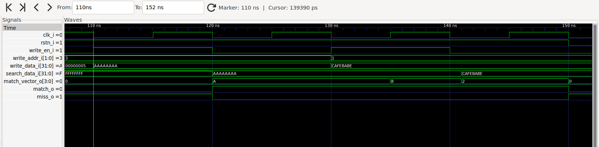

# Coding Challenge

## Implementation of Tightly-Coupled Data-Flow Integrity in RISC-V

### Hardware Track: 4-Entry, 32-Bit Content Addressable Memory

**Candidate:** Ruijue Luo

**Date:** 2 August 2026

**Language:** SystemVerilog

**Simulation tool:** Verilator 5.051

---

## 1. Objective

The hardware challenge requires the implementation of a four-entry, 32-bit Content Addressable Memory (CAM) in SystemVerilog.

The CAM must compare a 32-bit search value against all four stored entries and generate correct match and miss signals.

This submission contains:

- A synthesizable SystemVerilog CAM module.
- A self-checking SystemVerilog testbench.
- A Verilator simulation script.
- A Makefile for running the simulation.
- A simulation waveform captured using GTKWave.

---

## 2. CAM Overview

A conventional memory receives an address and returns the data stored at that address.

A Content Addressable Memory works in the opposite direction. It receives a data value and determines whether that value is stored in any entry.

This CAM contains four entries:

```text
Entry 0: 32-bit data and one valid bit
Entry 1: 32-bit data and one valid bit
Entry 2: 32-bit data and one valid bit
Entry 3: 32-bit data and one valid bit
```

The search input is compared against all valid entries in parallel.

For each entry, the match condition is:

```text
match_vector_o[i] =
    valid_q[i] && (entries_q[i] == search_data_i)
```

The overall match signal is:

```text
match_o = |match_vector_o
```

The miss signal is:

```text
miss_o = !match_o
```

Because the output is a match vector rather than an encoded address, multiple entries can match simultaneously.

---

## 3. Module Interface

| Signal | Direction | Width | Description |
|---|---|---:|---|
| `clk_i` | Input | 1 bit | Rising-edge clock |
| `rstn_i` | Input | 1 bit | Active-low asynchronous reset |
| `write_en_i` | Input | 1 bit | Enables a CAM write |
| `write_addr_i` | Input | 2 bits | Selects one of the four entries |
| `write_data_i` | Input | 32 bits | Data written into the selected entry |
| `search_data_i` | Input | 32 bits | Value compared against all CAM entries |
| `match_vector_o` | Output | 4 bits | Individual match result for each entry |
| `match_o` | Output | 1 bit | High when at least one entry matches |
| `miss_o` | Output | 1 bit | High when no entry matches |

---

## 4. Design Decisions

The implementation uses the following behavior:

- CAM writes are synchronous.
- A write occurs on the rising clock edge when `write_en_i` is high.
- CAM searches are combinational.
- Each entry has a valid bit.
- Reset clears all valid bits.
- Invalid entries never produce a match.
- Duplicate values are allowed.
- Multiple matches are represented by multiple asserted bits in `match_vector_o`.
- Writing to an existing address overwrites the previous value.

The signal suffixes follow common hardware naming conventions:

- `_i` indicates an input.
- `_o` indicates an output.
- `_q` indicates registered state.

---

## 5. RTL Implementation

File:

```text
rtl/cam_4x32.sv
```

```systemverilog
`timescale 1ns/1ps

module cam_4x32 (
  input  logic        clk_i,
  input  logic        rstn_i,

  input  logic        write_en_i,
  input  logic [1:0]  write_addr_i,
  input  logic [31:0] write_data_i,

  input  logic [31:0] search_data_i,

  output logic [3:0]  match_vector_o,
  output logic        match_o,
  output logic        miss_o
);

  logic [31:0] entries_q [0:3];
  logic [3:0] valid_q;

  always_ff @(posedge clk_i or negedge rstn_i) begin
    if (!rstn_i) begin
      valid_q <= '0;

      for (int unsigned i = 0; i < 4; i++) begin
        entries_q[i] <= '0;
      end
    end else if (write_en_i) begin
      entries_q[write_addr_i] <= write_data_i;
      valid_q[write_addr_i]   <= 1'b1;
    end
  end

  always_comb begin
    match_vector_o = '0;

    for (int unsigned i = 0; i < 4; i++) begin
      match_vector_o[i] =
          valid_q[i] && (entries_q[i] == search_data_i);
    end
  end

  assign match_o = |match_vector_o;
  assign miss_o  = !match_o;

endmodule : cam_4x32
```

### 5.1 Entry storage

The CAM data is stored in an unpacked array:

```systemverilog
logic [31:0] entries_q [0:3];
```

The array contains four elements, and each element contains 32 bits.

The valid state of each entry is stored separately:

```systemverilog
logic [3:0] valid_q;
```

### 5.2 Write operation

The write operation is implemented in an `always_ff` block:

```systemverilog
entries_q[write_addr_i] <= write_data_i;
valid_q[write_addr_i]   <= 1'b1;
```

When `write_en_i` is high, the selected entry is updated on the next rising clock edge.

### 5.3 Reset operation

The reset is active-low and asynchronous:

```systemverilog
always_ff @(posedge clk_i or negedge rstn_i)
```

When `rstn_i` becomes low, all valid bits and stored entries are cleared.

Clearing the valid bits is the functionally important part because invalid entries are excluded from the comparison.

### 5.4 Search operation

The search operation is implemented in an `always_comb` block.

Each entry is compared against `search_data_i`:

```systemverilog
match_vector_o[i] =
    valid_q[i] && (entries_q[i] == search_data_i);
```

Because the search logic is combinational, the output changes immediately after the search input or stored entries change.

---

## 6. Verification Strategy

The testbench verifies the following cases:

| Test | Operation | Expected result |
|---:|---|---|
| 1 | Search an empty CAM | Miss |
| 2 | Write and search entry 0 | `match_vector_o = 0001` |
| 3 | Write and search entry 1 | `match_vector_o = 0010` |
| 4 | Write and search entry 2 | `match_vector_o = 0100` |
| 5 | Write and search entry 3 | `match_vector_o = 1000` |
| 6 | Search for an absent value | Miss |
| 7 | Store the same value in two entries | Two simultaneous matches |
| 8 | Overwrite an existing entry | New value matches |
| 9 | Search for the overwritten value | Old entry no longer matches |
| 10 | Reset after writing entries | All searches miss |

The testbench is self-checking.

If an output does not match the expected result, the testbench calls `$fatal` and terminates the simulation.

---

## 7. Testbench Implementation

File:

```text
tb/cam_4x32_tb.sv
```

```systemverilog
`timescale 1ns/1ps

module cam_4x32_tb;

  logic        clk_i;
  logic        rstn_i;
  logic        write_en_i;
  logic [1:0]  write_addr_i;
  logic [31:0] write_data_i;
  logic [31:0] search_data_i;

  logic [3:0] match_vector_o;
  logic       match_o;
  logic       miss_o;

  cam_4x32 dut (
    .clk_i          (clk_i),
    .rstn_i         (rstn_i),
    .write_en_i     (write_en_i),
    .write_addr_i   (write_addr_i),
    .write_data_i   (write_data_i),
    .search_data_i  (search_data_i),
    .match_vector_o (match_vector_o),
    .match_o        (match_o),
    .miss_o         (miss_o)
  );

  always #5 clk_i = ~clk_i;

  task automatic write_entry(
    input logic [1:0]  address,
    input logic [31:0] data
  );
    begin
      @(negedge clk_i);

      write_en_i   = 1'b1;
      write_addr_i = address;
      write_data_i = data;

      @(negedge clk_i);

      write_en_i = 1'b0;
    end
  endtask

  task automatic check_search(
    input logic [31:0] search_value,
    input logic [3:0]  expected_vector
  );
    logic expected_match;

    begin
      expected_match = |expected_vector;
      search_data_i  = search_value;

      #1;

      if (match_vector_o !== expected_vector) begin
        $fatal(
          1,
          "search=0x%08h expected_vector=%b actual_vector=%b",
          search_value,
          expected_vector,
          match_vector_o
        );
      end

      if (match_o !== expected_match) begin
        $fatal(
          1,
          "search=0x%08h expected_match=%b actual_match=%b",
          search_value,
          expected_match,
          match_o
        );
      end

      if (miss_o !== !expected_match) begin
        $fatal(
          1,
          "search=0x%08h expected_miss=%b actual_miss=%b",
          search_value,
          !expected_match,
          miss_o
        );
      end

      $display(
        "PASS: search=0x%08h vector=%b match=%b miss=%b",
        search_value,
        match_vector_o,
        match_o,
        miss_o
      );
    end
  endtask

  initial begin
    clk_i         = 1'b0;
    rstn_i        = 1'b0;
    write_en_i    = 1'b0;
    write_addr_i  = 2'b00;
    write_data_i  = 32'b0;
    search_data_i = 32'b0;

    $dumpfile("build/cam_4x32_tb.vcd");
    $dumpvars(0, cam_4x32_tb);

    repeat (2) @(posedge clk_i);

    @(negedge clk_i);
    rstn_i = 1'b1;

    check_search(32'h00000000, 4'b0000);

    write_entry(2'd0, 32'h12345678);
    write_entry(2'd1, 32'hAAAAAAAA);
    write_entry(2'd2, 32'hDEADBEEF);
    write_entry(2'd3, 32'h00000005);

    check_search(32'h12345678, 4'b0001);
    check_search(32'hAAAAAAAA, 4'b0010);
    check_search(32'hDEADBEEF, 4'b0100);
    check_search(32'h00000005, 4'b1000);

    check_search(32'hFFFFFFFF, 4'b0000);

    write_entry(2'd3, 32'hAAAAAAAA);
    check_search(32'hAAAAAAAA, 4'b1010);

    write_entry(2'd1, 32'hCAFEBABE);
    check_search(32'hAAAAAAAA, 4'b1000);
    check_search(32'hCAFEBABE, 4'b0010);

    @(negedge clk_i);
    rstn_i = 1'b0;

    #1;
    check_search(32'hCAFEBABE, 4'b0000);

    $display("All CAM tests passed.");
    $finish;
  end

endmodule : cam_4x32_tb
```

---

## 8. Simulation Script

File:

```text
scripts/run_verilator.sh
```

```bash
#!/usr/bin/env bash

set -euo pipefail

PROJECT_ROOT="$(cd "$(dirname "${BASH_SOURCE[0]}")/.." && pwd)"
BUILD_DIR="${PROJECT_ROOT}/build"

mkdir -p "${BUILD_DIR}"

verilator \
  --binary \
  --timing \
  --trace \
  -Wall \
  -Wno-BLKSEQ \
  --top-module cam_4x32_tb \
  --Mdir "${BUILD_DIR}/obj_dir" \
  "${PROJECT_ROOT}/rtl/cam_4x32.sv" \
  "${PROJECT_ROOT}/tb/cam_4x32_tb.sv"

"${BUILD_DIR}/obj_dir/Vcam_4x32_tb"
```

The script performs the following steps:

1. Determines the project root directory.
2. Creates the build directory.
3. Compiles the RTL and testbench with Verilator.
4. Builds the simulation executable.
5. Runs the simulation.

---

## 9. Makefile

File:

```text
Makefile
```

```makefile
.PHONY: test clean

test:
	./scripts/run_verilator.sh

clean:
	rm -rf build
```

The commands below run the complete test:

```bash
make clean
make test
```

---

## 10. Simulation Results

The simulation produced the following results:

```text
PASS: search=0x00000000 vector=0000 match=0 miss=1
PASS: search=0x12345678 vector=0001 match=1 miss=0
PASS: search=0xaaaaaaaa vector=0010 match=1 miss=0
PASS: search=0xdeadbeef vector=0100 match=1 miss=0
PASS: search=0x00000005 vector=1000 match=1 miss=0
PASS: search=0xffffffff vector=0000 match=0 miss=1
PASS: search=0xaaaaaaaa vector=1010 match=1 miss=0
PASS: search=0xaaaaaaaa vector=1000 match=1 miss=0
PASS: search=0xcafebabe vector=0010 match=1 miss=0
PASS: search=0xcafebabe vector=0000 match=0 miss=1
All CAM tests passed.
```

All expected match and miss results were verified successfully.

---

## 11. Waveform

The following waveform was generated by the testbench and displayed using GTKWave:



At approximately 120 ns, searching for `0xAAAAAAAA` produces
`match_vector_o = 4'b1010`, because entries 1 and 3 both contain the
same value.

After entry 1 is overwritten with `0xCAFEBABE`,
`match_vector_o` changes to `4'b1000` for `0xAAAAAAAA`.

Searching for `0xCAFEBABE` produces `match_vector_o = 4'b0010`.

Finally, asserting reset clears all valid entries and produces
`match_vector_o = 4'b0000`, `match_o = 0`, and `miss_o = 1`.

---

## 12. Project Structure

```text
tc-dfi-cam-challenge/
├── Makefile
├── TC_DFI_CAM_Report.md
├── images/
│   └── cam_waveform.png
├── rtl/
│   └── cam_4x32.sv
├── scripts/
│   └── run_verilator.sh
└── tb/
    └── cam_4x32_tb.sv
```

